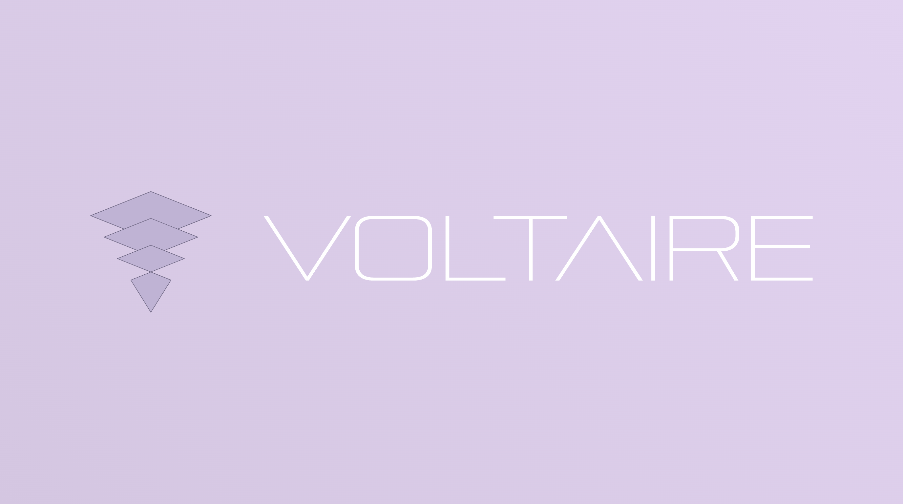

# Voltaire // design prototype

**Live prototype:** [voltaire.a-s-k.studio](https://voltaire.a-s-k.studio/)

A design prototype of the dormant Voltaire concept: the content of Voltaire's 2025 Framer page, implemented on [design-system-ASK](https://github.com/apexSolarKiss/design-system-ASK) under Voltaire's own identity. It provides no investment service and offers no signup, and the page collects nothing. Its statements are the 2025 presentation's, shown as they were written.

The design system supplies the interface, unchanged: type, color, the page shell and its navigation, the compact actions, the document register with its comparison tables, in light and dark. This site supplies its identity and content: Voltaire's mark and wordmark, the presentation's words, its figures, placed as the 2025 source vectors, the comparison tables' words and their 2025 ratings, and the implementer's section labels, framing lines and "About this prototype".

## Run it

The site is one static page with no build step and no dependencies to install.

- **Open it:** open `index.html` in a browser.
- **Or serve it:** from this folder, run `python3 -m http.server 8000` and visit `http://localhost:8000/`.

The page loads nothing from another site. Its links to other sites are ordinary links.

## What to edit

| Yours to edit | What it is |
|---|---|
| `index.html` | the page: its content, sections and navigation |
| `styles/voltaire.css` | local layout over the design system: the lockup's composition, the navigation control's compact height, measure, the comparison tables' width and columns, list spacing, figure placement and the printed page |
| `assets/figures/` // `assets/figures/light/` | the figures for the dark and the light theme; `FIGURES.md` lists each |
| `assets/identity.json` | the identity's parts and the ones this site shows: which symbol, which wordmark, how the two are composed and which theme the repository artwork takes |
| `assets/voltaire-symbol-light.svg` // `assets/voltaire-symbol-dark.svg` | the pyramid, for the light and the dark theme |
| `assets/voltaire-wordmark-deconstructed-light.svg` // `-dark.svg` | the wordmark the site shows, for the light and the dark theme |
| `assets/voltaire-wordmark-continuous-light.svg` // `-dark.svg` | the alternate wordmark, kept for reference and not shown |
| `tools/identity.py` | checks the page, its stylesheet and the repository artwork against `identity.json`, and builds and exports the artwork from it. Authoring only: the site never runs it |
| `favicon.svg` | the browser icon |
| `voltaire-ds-demo-banner.svg` | the repository artwork: the dark-theme lockup on the design system's dark gradient, built by `tools/identity.py build`. `voltaire-ds-demo-banner.png`, this README's banner, is its 2752 × 1536 export, and `og-image.png`, the page's link preview, its full-width centered crop to 1200:630, rendered at 1200 × 630, both by `tools/identity.py render` |

| Not to edit | Why |
|---|---|
| `_dsa-tokens/` // `_dsa-surface/` | design-system-ASK's files, copied unmodified. `VENDOR.md` lists them with their SHA-256, gives their load order and says how to re-sync them. A local difference goes in `styles/voltaire.css` instead. |
| `licenses/design-system-ASK/` | design-system-ASK's own license and notice, which travel with its files. |

**Identity.** The page opens on the lockup as Voltaire's 2025 Framer page composed it, the inverted pyramid beside the wordmark, across the column, with its `/// DESIGN PROTOTYPE` note. As the page scrolls, the wordmark leaves with it, and the pyramid alone stays as the navigation control: 87 px tall, top left on a desktop and bottom right on a phone. This is the design system shell's expanded identity. `styles/voltaire.css` declares the lockup's proportions, where each part sits in it, from the 2025 file, and the control's compact height; each part's artwork is bounded to its own painted edges, so the pyramid fills its control. The page's title, Voltaire, stays the document's heading and names the page in the navigation, but is not shown, because the wordmark already shows it.

**Selection.** `assets/identity.json` lists the identity's parts and names the ones the site shows: the pyramid, drawn point down, its cap meeting the stack at a single point; the deconstructed wordmark, the continuous lettering with parts of its O, A, R and E cut away; and the dark theme for the repository artwork. The continuous wordmark stays as an alternate. Both wordmarks fill the same box, so the lockup's numbers in `styles/voltaire.css` serve either. To change the selection, edit it there and point the page's four identity images at the chosen files, then run `python3 tools/identity.py build` and `render` for the artwork, and `check` until it passes. A part's `-light` or `-dark` suffix names the theme it is drawn for, not its color.

**Light and dark.** The page follows the reader's system setting. In the dark theme the pyramid and the wordmark are the 2025 file's own colors: lavender outlines and lettering, and black plates. In the light theme the wordmark is white, and the pyramid takes the light figures' colors, the design system's diagram ink for its outlines and its node fill for its plates, so it sits with the figures and the stack still reads as stacked. Each figure shows its matching file; the two charts, "how it works" and the futures market share, take the style guide's colors in both themes (`FIGURES.md`).

**Navigation.** The navigation panel is built by `_dsa-surface/surface-shell.js` from the `<template class="surface-nav-source">` at the foot of the page. Its entries are the page's sections: choosing one closes the panel and moves to that section. Below them, the template's `surface-nav-utilities` row carries two routes off the page, the repository and design-system-ASK, which open in a new tab. To add a section, give its heading an `id` and add a row for it to the template.

## Deploy it

`vercel.json` serves the folder as it is, with no install or build step, and sets the same security headers as the design system's own site. Any static host works the same way: serve the repository root.

## Licenses

The code and reusable interface implementation in this repository are licensed under the Apache License 2.0 (`LICENSE`). `NOTICE` lists what else is included and under what terms. The design-system files are Apache-2.0, and the typefaces are under the SIL Open Font License 1.1.

Voltaire identity artwork created by Andrew S Klug // ASK, including logos and wordmark artwork, is excluded from the Apache License 2.0. All rights reserved. Here that is the symbol and wordmark files in `assets/`, `favicon.svg` and the repository artwork that shows them: `voltaire-ds-demo-banner.svg`, `voltaire-ds-demo-banner.png` and `og-image.png`. The presentation's content and its figures keep their own rights and are not covered by this repository's license.
